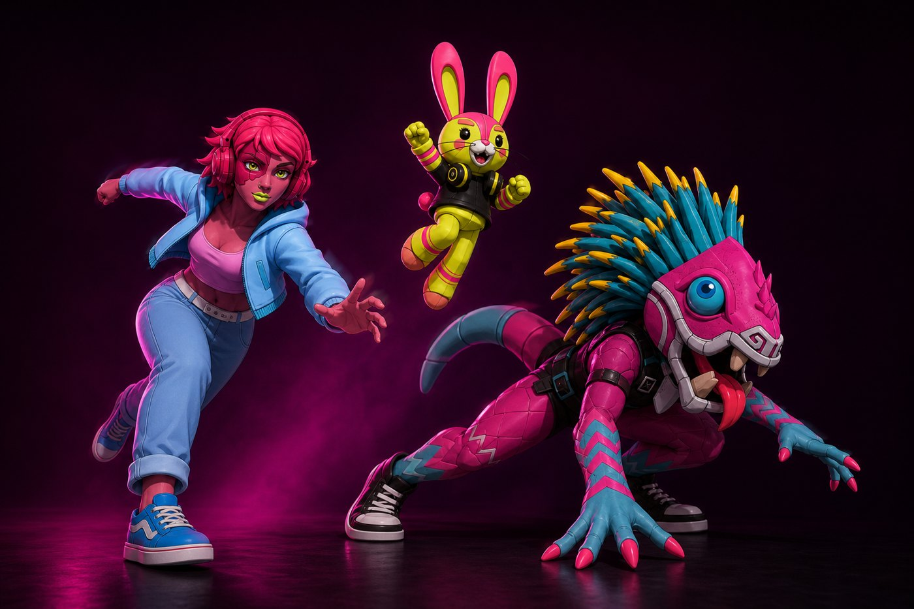
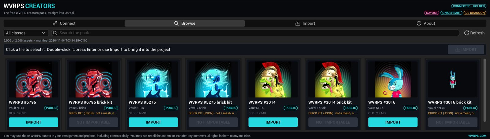
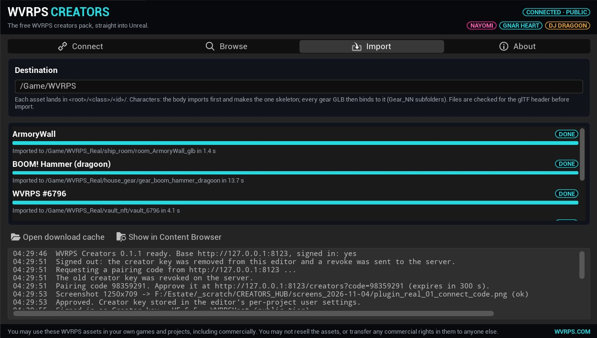
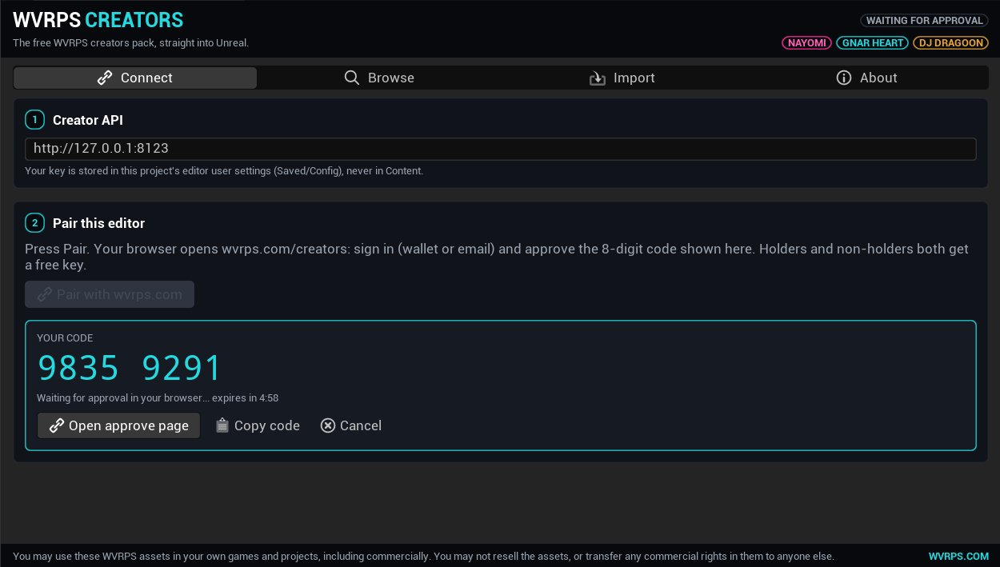

  

<h1 align="center">WVRPS Creators <code>UE 5.4 / 5.5</code></h1>

  <b>The WVRPS crew, straight into your Unreal project.</b> 
  484 WVRPS characters, 1,300+ gear pieces, the ship room, the chess set, brick kits and every character's own song &mdash; free for your game.

  <a href="https://wvrps.com/creators">Get your free key</a> &nbsp;&middot;&nbsp;
  <a href="INSTALL.md">Install</a> &nbsp;&middot;&nbsp;
  <a href="../../releases">Releases</a> &nbsp;&middot;&nbsp;
  <a href="https://wvrps.com">wvrps.com</a>

 

## What it does

| | |
|---|---|
| **Pair with a code** | The panel shows an 8-digit code, you approve it on wvrps.com/creators while signed in (email, Google or wallet). No passwords in the editor, ever. |
| **Browse the pack** | 2,900+ assets with thumbnails, class filter and search: vault characters, gear, rooms, chess, brick kits, music. |
| **One-click import** | Interchange glTF import into `/Game/WVRPS/<class>/`. Characters land as body + gear on **one** skeleton; songs as SoundWaves. |
| **Holder extras** | Hold a WVRPS? Your own characters show up on top of the public pack. |
| **Fair use built in** | 200 MB per key per day, 5 keys per account, revoke from your Signed-in devices on wvrps.com. |

## Quick start

1. Download the zip for your engine from **Releases** and unzip it into `<YourProject>/Plugins/`.
2. Open the project, enable **WVRPS Creators** (Edit &rarr; Plugins), restart.
3. Window &rarr; **WVRPS Creators** &rarr; **Pair**. Approve the code at <https://wvrps.com/creators>.
4. Browse, click a tile, **Import**.

Building from source: stock Epic UE 5.4 or 5.5 with the usual C++ toolchain; `RunUAT BuildPlugin -Plugin=WVRPSCreators.uplugin`.

## Licence

Plugin code: MIT ([LICENSE](LICENSE)).

WVRPS assets: you may use them in your own games and projects, including commercially. You may not resell the assets or transfer any commercial rights in them to anyone else.

Nayomi &middot; Gnar Heart &middot; DJ Dragoon &mdash; <a href="https://wvrps.com">WVRPS</a>

