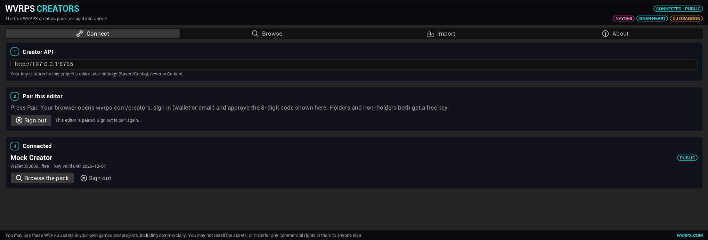
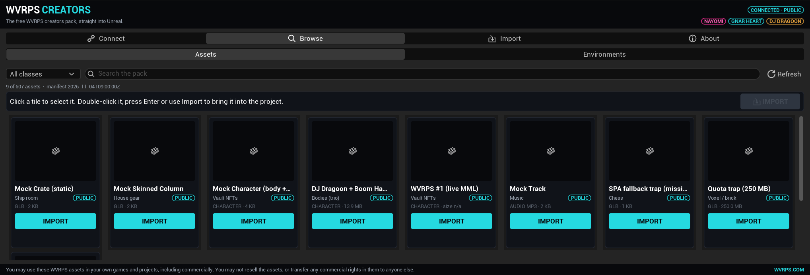
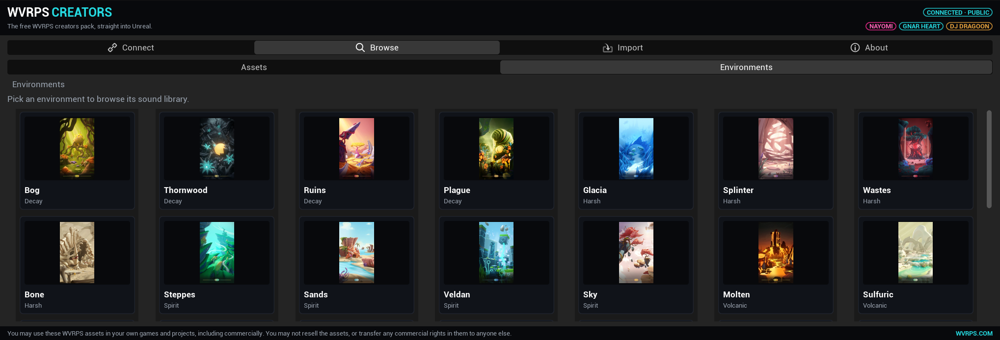
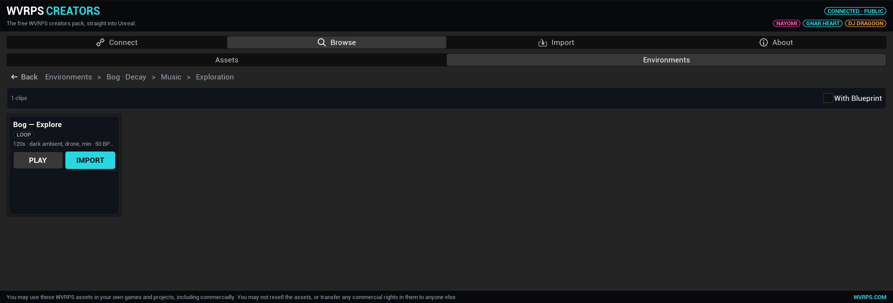

# WVRPS Creators

Unreal Engine editor plugin that pulls the free WVRPS creators pack straight into your project — characters,
gear, rooms, music and the Otherside sound library — with a free creator key.

**This repository is the plugin source code only — it contains no WVRPS assets.** The 3D models, audio and
environments are served by WVRPS Studio through the wvrps.com creator API after you pair. See `LICENSE`: the
code is MIT, but the assets and the WVRPS name/characters/marks are NOT covered by it and are licensed separately.

## Quick start

1. Install the plugin (see `INSTALL.md` for your engine) and enable it (Edit > Plugins > WVRPS Creators).
2. Window > Developer Tools > Misc > **WVRPS Creators** (or console `WVRPS.Creators.Open`).
3. **Connect** tab: press **Pair with wvrps.com**. Your browser opens `https://wvrps.com/creators?code=<code>`;
   sign in (email or wallet) and approve. Holders and non-holders both get a free key.
4. **Browse** and press **IMPORT**. Assets land in `/Game/WVRPS/<class>/<item>/`.

## Two browse modes

**Assets** — the whole 3D pack: ship-room props, chess, printables, fitted gear, vault NFTs and WVRPS
characters (MML), plus music. Filter by class, search, import. Characters import as a body first, then every
gear GLB bound to the body's skeleton.

**Environments** — the Otherside sound library, drilled down 29 biomes → Music / SFX → category → clips.
Each clip has **PLAY** (preview before importing) and **IMPORT**. The "With Blueprint" toggle makes the import
also create a SoundCue + a placeable Blueprint actor.

## Licence

Plugin source: MIT (see `LICENSE`). WVRPS assets: you may use them in your own games and projects, including
commercially; you may not resell the assets or transfer any commercial rights in them to anyone else.

Support: https://wvrps.com/creators
